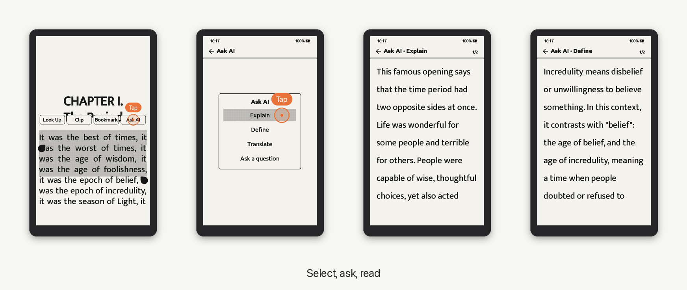

<h1 align="center">PageMind</h1>

<p align="center">
  <strong>Ask your e-reader about what you are reading.</strong><br>
  Open-source firmware for the Xteink X4 Pro with an AI reading companion that runs on <em>your own</em> cloud.
</p>

<p align="center">
  <a href="https://github.com/nadeemcite/pagemind/releases/latest"></a>
  
  <a href="LICENSE"></a>
</p>

<p align="center"></p>

---

You are reading, and you hit a word you don't know, a sentence you can't untangle,
a line in a language you are still learning. Normally you put the book down and
reach for your phone. With PageMind you **select the passage, tap Ask AI, and read
the answer right there on the e-ink screen**, then carry on from the same page.

PageMind is built on [CrossPoint Reader](https://github.com/crosspoint-reader/crosspoint-reader),
the open-source firmware for Xteink devices, and keeps everything CrossPoint does.
It is **not** an official CrossPoint release. Please report PageMind problems
[here](https://github.com/nadeemcite/pagemind/issues), not to CrossPoint.

## What you can ask

| | Task | You get |
|---|---|---|
| 💡 | **Explain** | The passage in simple words |
| 📖 | **Define** | The meaning of a word or phrase *as it is used here* |
| 🌐 | **Translate** | The passage in the language you choose |
| 💬 | **Ask a question** | An answer to your own question about the passage |

<p align="center"></p>

<p align="center"></p>

**Made for real books:**

- **No spoilers.** Only the page on your screen is sent, never the pages ahead.
- **Your languages.** Answers render in your reading font, including Hindi and other
  Indic scripts, with proper conjuncts and vowel signs.
- **Stays out of the way.** Wi-Fi turns on only when you ask, and turns off again.
- **Plain text on e-ink.** Short answers, paged like a book, no clutter.

<p align="center"></p>

## Your cloud, your data

PageMind has no PageMind server. Ask AI talks only to an AI server that **you**
run in your own Google Cloud project, with your own OpenAI or Ollama key.


- **What is sent:** the selected text, the page on screen, the book title and
  author, and your answer language. Nothing else.
- **Where it goes:** to your server, which forwards it to the provider you chose
  (under that provider's terms). Nothing goes to the PageMind project.
- **What is kept:** your server logs only sizes and timing, never book text or answers.
- **Your key:** the reader stores its key encrypted with a secret that never leaves
  the device; the provider key stays in your Google Secret Manager.

## Get started

You need an **Xteink X4 Pro**, a **Google Cloud** project with billing turned on,
and an API key from **OpenAI** or **[Ollama](https://ollama.com)**. Setup takes
about 15 minutes.

### 1. Install PageMind on the reader

1. Back up the SD card's `/.crosspoint/` folder (progress, settings, bookmarks).
2. Download `pagemind-<version>-x4pro.bin` from the
   [latest release](https://github.com/nadeemcite/pagemind/releases/latest).
3. Connect the X4 Pro by USB-C, wake it, and flash the file with the
   [CrossPoint web flasher](https://crosspointreader.com/#flash-tools)
   (select X4 Pro → *Custom .bin*), or with
   `esptool.py --chip esp32s3 --baud 921600 write_flash 0x10000 pagemind-<version>-x4pro.bin`.

Your books, fonts, settings and reading progress are kept.

> [!WARNING]
> Some units bought from third-party stores have USB flashing locked. CrossPoint's
> unlock tool officially supports only CrossPoint and CrossInk, and flashing other
> firmware on a locked device may leave it stuck. Read
> [CrossPoint's warning](https://github.com/crosspoint-reader/crosspoint-reader#usb-locked-devices-xteink-unlocker)
> before you start.

### 2. Deploy your AI server

```bash
git clone https://github.com/nadeemcite/pagemind.git
cd pagemind/cloud/ai-proxy
./deploy.sh
```

The script asks for your project, provider and model, stores your provider key in
Secret Manager, deploys the server, and writes **`pagemind-ai.json`** with the
server URL and a key for your reader. Details and options:
[cloud/ai-proxy](cloud/ai-proxy/README.md).

### 3. Connect the reader

Copy `pagemind-ai.json` to the **root of the SD card** and restart the reader.
PageMind imports it, encrypts the key, turns Ask AI on, and deletes the file.
Then delete your computer's copy: it holds the key in plain text.

Prefer not to copy files? Start **File Transfer** on the reader, open its address in
a browser, and paste the URL and key under **Settings → AI Assistant**.

Check it: **Settings → Network → AI Assistant → Test connection**.

### 4. Ask

Open a book, hold a word and drag to select a passage, tap **Ask AI**, pick a task.
**Back** returns you to the same page.

Answers come in the reader's language by default; choose another under
**Settings → Network → AI Assistant → Answer Language**.

## Cost

You pay your own Google Cloud and AI provider bills; PageMind is free.
The server sleeps when you are not using it, so occasional reading usually fits in
or near Cloud Run's free tier (stored container images may cost a few cents a
month). AI costs depend on your provider and model. Set a spending limit at your
provider and a budget alert in Google Cloud. Each reader key is limited to
10 questions a minute.

## FAQ

<details>
<summary><strong>Can I use my ChatGPT, Claude or Gemini subscription?</strong></summary>

No. Those subscriptions cover the providers' own apps, not other software. PageMind
uses an API key, which you create in the provider's developer console. Ollama's
cloud offers open models; OpenAI keys work too.
</details>

<details>
<summary><strong>Does it work offline?</strong></summary>

Reading does, and so do the offline dictionary, highlights and bookmarks. Ask AI
needs Wi-Fi to reach your server, like CrossPoint's sync and OPDS features.
</details>

<details>
<summary><strong>Which devices are supported?</strong></summary>

The Xteink X4 Pro. CrossPoint runs on more devices; PageMind will add them once
they can be tested.
</details>

<details>
<summary><strong>How do updates work?</strong></summary>

**Settings → Check for updates** installs the latest PageMind release from this
repository. It never installs official CrossPoint.
</details>

<details>
<summary><strong>Can I go back to CrossPoint?</strong></summary>

Yes. Flash official CrossPoint with the web flasher. Your books and progress stay on
the SD card.
</details>

<details>
<summary><strong>The first question takes a few seconds longer. Why?</strong></summary>

Your server sleeps when idle to keep costs near zero, and wakes up on the first
request. Later questions answer in about two seconds.
</details>

## Everything else

PageMind includes all of CrossPoint Reader: EPUB rendering, custom fonts,
dictionary lookups, highlights and clippings, KOReader sync, OPDS, file transfer and
more. See [CrossPoint's README](https://github.com/crosspoint-reader/crosspoint-reader#readme)
and the [user guide](USER_GUIDE.md). It also includes Indic script shaping from
CrossPoint [PR #3787](https://github.com/crosspoint-reader/crosspoint-reader/pull/3787).

## For developers

Build, release and upstream sync: [docs/pagemind-development.md](docs/pagemind-development.md).
How the feature was planned and tested: [planning/](planning/README.md).

## Credits and license

PageMind stands on [CrossPoint Reader](https://github.com/crosspoint-reader/crosspoint-reader)
and its contributors, the [FreeInk SDK](https://freeink.org), and
[@ssafayet](https://github.com/ssafayet)'s Indic shaping work.
MIT licensed, like CrossPoint; CrossPoint's copyright notice is kept in [LICENSE](LICENSE).
